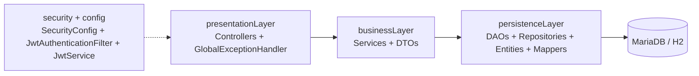

# Flujo del Sistema — Biblioteca farsheen (Backend)

API REST en **Spring Boot 4.1.1 + Java 21 + Spring Security 7 + JPA/MariaDB** bajo `/biblioteca/api/v1`.

## 1. Capas y responsabilidad

- **presentationLayer:** valida `@Valid`, extrae identidad del `Authentication` y delega al servicio; `GlobalExceptionHandler` normaliza errores `{timestamp, status, error, message, details?}`.
- **businessLayer:** aplica reglas de negocio, transacciones, bloqueo pesimista y escapes `LIKE`; nunca expone entidades JPA ni contraseñas.
- **persistenceLayer:** DAOs + Spring Data JPA + MapStruct; bajas lógicas (`estado = false`), nunca borrado físico.

## 2. Flujo de seguridad (Login → JWT → Autorización → Ownership)
1. **Login (`POST /auth/login`):** verifica BCrypt y `estado == true`; si falla devuelve `401` genérico; si acierta emite JWT HS256 (clave ≥ 32 bytes) con `sub=correo` y `rol`.
2. **Filtro (`JwtAuthenticationFilter`):** extrae `Bearer <token>`, valida firma y expiración con `JwtService` (rechaza `alg=none`), consulta el usuario activo (`estado == true`) en BD y puebla `SecurityContextHolder`.
3. **Autorización (`SecurityConfig`):** `STATELESS`, CORS explícito sin `*`, `permitAll` solo en `/auth/**` y `GET /catalogo/**`, reglas `ADMIN`/`USUARIO` y `anyRequest().authenticated()` al final.
4. **Ownership:** en `GET /reservas/{id}` y `PATCH /reservas/{id}/cancelar`, el servicio comprueba que el `idUsuario` o correo pertenezca al usuario del token (salvo `ADMIN`).

## 3. Flujo de una reserva (`POST /reservas`)
1. `ReservaController` valida `@Valid ReservaCreateDTO` y pasa el correo del token autenticado.
2. `ReservaServiceImpl.crear` (`@Transactional`) valida usuario y adquiere **bloqueo pesimista** (`PESSIMISTIC_WRITE`) sobre el libro (`findEntityByIdForUpdate`) para evitar condiciones de carrera entre dos reservas simultáneas.
3. Verifica `estado == true`, `fechaInicio > ahora` y `fechaEntrega > fechaInicio`.
4. Consulta `ejemplarDao.findDisponiblesEnRango` (ejemplares `DISPONIBLE` sin reserva `ACTIVA` solapada).
5. Asigna el primer ejemplar libre, persiste la reserva `ACTIVA` y retorna `ReservaDTO` (`201 Created`).

## 4. Perfiles de ejecución
- **Desarrollo (`dev`, por defecto):** `./gradlew bootRun` (MariaDB `127.0.0.1:3307`, Swagger activo).
- **Seed idempotente (≥ 40 libros reales):** `SPRING_PROFILES_ACTIVE=dev,seed ./gradlew bootRun`
- **Pruebas:** `./gradlew clean test` (H2 en memoria, perfil `test`).
- **Producción (`prod`):** requiere `DB_HOST`, `DB_PORT`, `DB_NAME`, `DB_USER`, `DB_PASSWORD`, `JWT_SECRET` (≥ 32 bytes), `ADMIN_PASSWORD`, `CORS_ALLOWED_ORIGINS` (sin defaults, `ddl-auto=validate`, Swagger desactivado).
